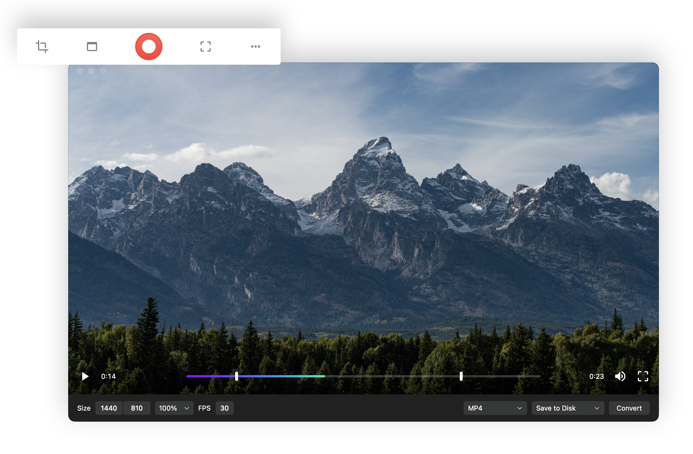

  

<h1 align="center">Kapp</h1>

Capture your screen. Trim it. Share it.

> [!NOTE]
> Kapp's UI design and interaction model are based entirely on [Kap](https://getkap.co/), reimplemented with native macOS components. Recording, audio, and parts of area selection use source code adapted from [BetterCapture](https://github.com/jsattler/BetterCapture). Both projects' original copyright and license notices are retained.

A native macOS screen recorder with area, window, and full-screen capture, a simple trimming editor, and MP4 or GIF export.

## Features

- **Capture:** Draw an area, choose a window, or record a whole display. Adjust dimensions and aspect ratio before starting.
- **Audio:** Record system audio, your microphone, or both. Include or hide the mouse cursor.
- **Controls:** Start or stop with `⌘⇧5`. Option-click the recording menu bar icon to pause; click it while paused to resume.
- **Trim:** Preview your recording and drag either endpoint to keep the part you need. Hover over the timeline to preview frames.
- **Export:** Choose MP4 or GIF, adjust dimensions and frame rate, then save to disk or copy to the clipboard. Original recordings are kept locally.

## Get started

Requires macOS 15.2 or later. Kapp is currently available as a source build; see the [development guide](docs/development.md) for Xcode requirements, building, and local signing.

Launch Kapp, then click its menu bar icon or press `⌘⇧5` to select an area. The window and full-screen buttons change what is recorded; click the red button to start. Click the menu bar icon again to stop and open the editor. Press `Escape` to cancel selection.

In the editor, drag the two timeline handles to trim, choose an output format and destination, then click **Convert**. Disk exports initially open on Desktop and remember the last folder chosen. Original recordings are stored in `~/Movies/Kapp`. Use **Open Recording…** or `⌘O` to edit an existing video.

## Development

See [Development](docs/development.md) for build instructions and tests, and [Releasing](docs/releasing.md) for version upgrades, GitHub Actions, and release packaging.

## Credits

- [Kap](https://github.com/wulkano/Kap) by [Wulkano](https://wulkano.com): the UI design and interaction model, capture and playback icons, and adapted conversion test cases.
- [BetterCapture](https://github.com/jsattler/BetterCapture) by [Joshua Sattler](https://github.com/jsattler) and contributors: selected recording, audio timing, display sizing, area selection, and selection-border implementations.
- [Grand Teton National Park / USGS](https://www.usgs.gov/media/images/grand-tetons-grand-teton-national-park): public-domain landscape used in the native UI overview.

See [Third-party notices](THIRD_PARTY_NOTICES.md) for source revisions and retained licenses. Kapp is an independent project and is not affiliated with either upstream project.

## License

[MIT](./LICENSE) License © [jinghaihan](https://github.com/jinghaihan) for original contributions. Adapted code and assets retain their original copyright and MIT license notices.
